<h3><code>yazan@github ~ $ whoami</code></h3>
<table>
<tr>
<td valign="top"></td>
<td valign="top"></td>
</tr>
</table>

 

<h3><code>yazan@github ~ $ ./contributions.sh</code></h3>

  

<h3><code>yazan@github ~ $ ls ~/work --selected</code></h3>

| Project | What it does | Built with |
|---|---|---|
| [**Together**](https://yaznhijazi.runs-on.dev/project-together.html) | Jo Academy's all-in-one team app for ~1,000 employees: calendar, chat, tasks, team management and Ping, an AI assistant | Vite · Supabase · Realtime · Web Push · PWA |
| [**Cairn**](https://yaznhijazi.runs-on.dev/project-cairn.html) | An AI automation team: 13 AI specialists read Bitrix24, n8n and Metabase, then plan, build and fix automations, with a human approving every change | Next.js · React · Claude / GPT / Gemini · n8n MCP |
| [**Candor**](https://yaznhijazi.runs-on.dev/project-candor.html) | An autonomous AI recruiter: screens candidates, runs live voice interviews in Jordanian Arabic or English, and hands over an evidence-checked report | Supabase Edge Functions · pg_cron · Gemini Live |

 

<h3><code>yazan@github ~ $ n8n list --active</code></h3>

| Automation at Jo Academy | |
|---|---|
| **60+ business processes** | Automated end to end in Bitrix24 for ~700 people |
| **ERP + HR integration** | Bitrix24 as ERP/CRM, synced with the HR system so manual entry drops |
| **n8n workflows** | IVR, WhatsApp chatbot, email approvals |
| **Dashboards** | Metabase and Power BI KPI reports, Python and SQL underneath |

<b>Earlier side projects</b>

 

| Project | What it is |
|---|---|
| [Norna](https://github.com/yaznhijazii/Norna-V2) · [live](https://norna-v2.vercel.app) | Daily Islamic planner for couples |
| [Customer Churn](https://github.com/yaznhijazii/ChurnCustomer) | Churn prediction with ML + Power BI dashboards |
| [AAPL Forecasting](https://github.com/yaznhijazii/AppleStockPricePrediction) | Apple stock forecasting, ARIMA vs LSTM |
| [Flipkart Sentiment](https://github.com/yaznhijazii/FlipkartNLP) | Sentiment analysis on product reviews |

 

<h3><code>yazan@github ~ $ cat contact.txt</code></h3>

